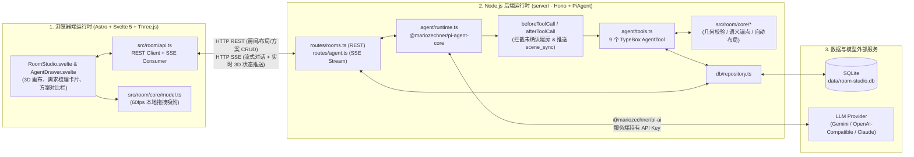

# Room Studio 后端 PiAgent + SQLite 架构与实现计划

## Goal Description

为 `/agent/` 房间工作台构建一套**轻量化后端驱动的 PiAgent 架构**（Node.js 22 + Hono + SQLite + `@mariozechner/pi-agent-core`），同时保持博客其余页面（`/`、`/blog/`、`/archive/`、`/about/`）继续以纯静态 Astro 站点构建。

通过**前后端共享同一套纯 TypeScript 空间几何引擎**，实现以下四大核心能力：
1. **多用户持久化与安全调用**：API Key 完全保存在后端环境变量中，房间、家具布局、方案快照与对话草稿全部持久化到轻量化 **SQLite** 数据库，任何访客打开页面即可开箱使用，刷新或跨端均可恢复数据。
2. **「需求梳理 → 确认执行」双阶段建房（Clarify-then-Act）**：
   - 用户模糊描述新房间时，后端 `PiAgent` 先调用 `update_room_draft` 将已知/暂定/待追问字段持久化到当前会话草稿，并通过 SSE 推送给前端展示**「房间需求梳理卡片」**与 3D 半透明线框预览。
   - 用户确认（口头回复确认或点击卡片确认按钮）后，才放行 `commit_room_draft` 校验几何合法性并向 SQLite 写入新房间（**不覆盖原有房间**）。
3. **语义化家具摆位与微调（方向 #1）**：支持“靠北墙、放西窗下、紧挨双人床左侧”等语义锚点放置、移动、旋转与移除家具。
4. **一键场景化自动布局 & 方案快照对比（方向 #3）**：支持按预设风格（居家办公优先 / 休闲观影 / 温馨卧室 / 极简留白）自动排布零冲突布局，并支持将方案存入 SQLite 快照表，随时一键切换与 A/B 对比。

---

## User Review Required

> [!IMPORTANT]
> **1. 后端技术栈选型（极简、零外部依赖）**
> - **HTTP & SSE 服务框架**：`hono` + `@hono/node-server`（轻量 TypeScript-first 后端框架，原生支持 `streamSSE` 流式推送，非常适合与 `PiAgent` 事件流对接）。
> - **数据库**：**SQLite**（使用 `better-sqlite3` 或 Node 22 内置 `node:sqlite`，单文件 `data/room-studio.db`，零 Docker、零外部数据库运维）。
> - **本地开发联调**：通过 `astro.config.mjs` 的 Vite `server.proxy` 将 `/api/*` 自动转发到本地后端端口（默认 `http://localhost:8787`），前端代码统一请求 `/api/...`，上线后直接用 Nginx/Caddy 反代即可。

> [!IMPORTANT]
> **2. 共享几何内核设计（避免前后端逻辑重复）**
> 将 `src/room/model.ts` 和新增的 `layout-engine.ts` 抽离为**纯 TypeScript、零 DOM/Three.js 依赖**的核心层（`src/room/core/`）：
> - **前端**用它做拖拽时的 60fps 实时边界吸附和即时冲突提示；
> - **后端 PiAgent 工具**直接 import 同一份代码做严格的几何校验、语义锚点解算和自动布局，保证前后端计算结果 100% 一致。

---

## Open Questions

> [!NOTE]
> 开始编码前，请确认以下 2 个后端偏好：
> 1. **默认对接的 LLM 提供商**：后端 `.env` 默认配置哪家模型？（支持 **OpenAI 兼容接口**如 DeepSeek/OpenAI/中转站、**Google Gemini API** 或 **Anthropic Claude**，计划通过 `@mariozechner/pi-ai` 同时兼容这几类，只需在 `.env` 配 `LLM_PROVIDER`、`LLM_API_KEY`、`LLM_MODEL`、`LLM_BASE_URL` 即可切换）。
> 2. **多用户数据隔离方式**：初期是否采用**“公共空间 + 匿名访客会话 ID（`sessionId` 存 Cookie/localStorage）”**？即所有访客共享默认示例房间，新建的房间和对话草稿按 `workspaceId` / `sessionId` 隔离存储（未来随时可升级为账号登录系统）。

---

## 目录结构设计（Directory Structure）

将前后端清晰分层，保持 `laojun.com` 仓库整洁，一眼就能看清前端、共享内核、后端服务与数据存储的边界：

```text
laojun.com/
├── data/                              # [RUNTIME, gitignored] 轻量化本地数据目录
│   └── room-studio.db                 # SQLite 单文件数据库（自动初始化建表）
│
├── server/                            # [NEW] 独立轻量化 Node.js 后端服务 (Backend Runtime)
│   ├── index.ts                       # 服务入口：启动 Hono HTTP Server、CORS、静态/健康检查
│   ├── env.ts                         # 环境变量加载与校验 (PORT, DB_PATH, LLM_API_KEY 等)
│   ├── db/
│   │   ├── sqlite.ts                  # SQLite 连接管理、自动建表迁移与默认房间 Seed
│   │   ├── schema.sql                 # SQLite 表结构定义 (rooms / layout_variants / agent_sessions)
│   │   └── repository.ts              # 数据访问层 (RoomRepo, VariantRepo, SessionRepo)
│   ├── routes/
│   │   ├── rooms.ts                   # 房间 & 家具布局 & 方案快照的 REST CRUD API
│   │   └── agent.ts                   # Agent 对话 SSE 流式接口 (POST /api/agent/chat) & 草稿确认接口
│   └── agent/
│       ├── runtime.ts                 # PiAgent 实例封装 (streamSimple、beforeToolCall/afterToolCall 护栏)
│       ├── tools.ts                   # 9 个空间 AgentTool 实现（TypeBox Schema + 调用 Repo & Core）
│       └── prompt.ts                  # System Prompt 与「需求梳理 → 确认建房」协议
│
├── src/
│   ├── pages/
│   │   └── agent.astro                # 房间工作台入口页
│   └── room/
│       ├── core/                      # [NEW/MOVED] 前后端共享纯 TS 空间内核（零 DOM/WebGL 依赖）
│       │   ├── model.ts               # RoomSpec、RoomDraft、家具尺寸、边界约束、碰撞检测、几何校验
│       │   └── layout-engine.ts       # 语义锚点解算、4 种场景化一键自动布局、A/B 方案对比算法
│       ├── api.ts                     # [NEW] 前端 API Client（封装 fetch REST 与 SSE 流解析）
│       ├── scene.ts                   # Three.js 3D 场景与家具模型（支持动态 RoomSpec 重建与草稿预览）
│       ├── viewport.ts                # Three.js 渲染循环、相机与拖拽交互
│       ├── RoomStudio.svelte          # 主工作台（多房间切换、方案对比栏、拖拽同步后端）
│       ├── AgentDrawer.svelte         # [NEW] 底部悬浮提问栏 + 可折叠对话抽屉 + 需求梳理确认卡片
│       └── studio.css                 # 纯白毛玻璃工作台样式
│
├── scripts/
│   ├── room-model.test.mjs            # 既有几何与碰撞单元测试
│   └── room-agent.test.mjs            # [NEW] 后端 SQLite Repo、PiAgent 工具、双阶段护栏集成测试
│
├── .env.example                       # [NEW] 后端环境变量模板（不提交真实 Key）
├── astro.config.mjs                   # [MODIFY] 开发环境增加 Vite `/api` 代理到后端 8787 端口
└── package.json                       # [MODIFY] 新增 dev:server / dev:all / test 脚本与依赖
```

---

## 整体运行时与数据流架构（Runtime Architecture）



### 各运行时（Runtimes）职责明细

| 运行时环境 | 所在位置 | 新增与挂载内容 |
| :--- | :--- | :--- |
| **1. Node.js 后端运行时**<br>*(Backend API + Agent Runtime)* | `server/**` | • **SQLite 持久化**：自动建表、写入默认个人房间种子数据、持久化多房间/家具布局/方案快照/对话草稿。<br>• **REST 接口**：供前端加载房间列表、保存手动拖拽后的家具坐标、一键切换方案快照、撤销恢复。<br>• **PiAgent 运行时**：接收用户消息，从 SQLite 加载上下文与草稿，运行 `Agent` 循环，通过 `beforeToolCall` 强制执行双阶段建房护栏，通过 **SSE** 实时向前端推送文字流、工具回执、草稿卡片更新和最新 3D 场景快照。 |
| **2. 浏览器端运行时**<br>*(Browser Client Runtime)* | `src/room/**` | • **3D 渲染与交互**：Three.js 动态渲染任意 `RoomSpec` 房间和草稿虚线预览；手动拖拽时先用共享 `model.ts` 保持 60fps 流畅度，松手后异步 `PUT /api/rooms/:id/layout` 落库。<br>• **SSE 实时联动**：收到后端推送的 `draft_updated` / `scene_sync` 事件后，无需刷新页面即可实时更新需求梳理卡片和 3D 家具位置。 |
| **3. Node.js 测试运行时**<br>*(Test Runtime)* | `scripts/*.test.mjs` | • 使用内存 SQLite（`:memory:`）跑通完整的 Repo 读写、9 个 Agent 工具调用、双阶段护栏拦截与自动布局零冲突验证。 |

---

## SQLite 数据库表设计（`server/db/schema.sql`）

仅需 **3 张核心表**，结构清晰直观，易于排查和扩展：

```sql
-- 1. 房间与当前家具布局表
CREATE TABLE IF NOT EXISTS rooms (
  id           TEXT PRIMARY KEY,          -- 例如 'personal-bedroom' 或 'room-xxxx'
  workspace_id TEXT NOT NULL DEFAULT 'default',
  name         TEXT NOT NULL,             -- 房间名称，如 '个人主卧'、'新建书房'
  spec_json    TEXT NOT NULL,             -- 序列化的 RoomSpec (长宽高、门窗、卫生间、过道)
  items_json   TEXT NOT NULL,             -- 序列化的 RoomItem[] (当前摆放的家具列表)
  created_at   INTEGER NOT NULL,
  updated_at   INTEGER NOT NULL
);

-- 2. 场景化布局方案快照表（方向 #3：多方案对比）
CREATE TABLE IF NOT EXISTS layout_variants (
  id           TEXT PRIMARY KEY,
  room_id      TEXT NOT NULL REFERENCES rooms(id) ON DELETE CASCADE,
  name         TEXT NOT NULL,             -- 如 '方案A-居家办公'、'方案B-休闲观影'
  style        TEXT,                      -- 'work_focus' | 'relax_cinema' | 'custom' 等
  items_json   TEXT NOT NULL,             -- 该方案对应的 RoomItem[] 快照
  created_at   INTEGER NOT NULL
);

-- 3. Agent 对话与建房需求梳理草稿表
CREATE TABLE IF NOT EXISTS agent_sessions (
  id              TEXT PRIMARY KEY,       -- 会话 ID
  workspace_id    TEXT NOT NULL DEFAULT 'default',
  active_room_id  TEXT NOT NULL,          -- 当前正在操作的房间 ID
  draft_json      TEXT,                   -- 正在梳理中的 RoomDraft JSON（未确认前暂存于此）
  messages_json   TEXT NOT NULL,          -- PiAgent 精简对话历史
  updated_at      INTEGER NOT NULL
);
```

---

## 后端接口契约（REST + SSE）

| 接口 | 方法 | 作用 |
| :--- | :--- | :--- |
| `/api/rooms` | `GET` | 获取当前工作区的所有房间列表、默认激活房间及各房间的方案快照 |
| `/api/rooms/:id/layout` | `PUT` | 前端手动拖拽/旋转/增删/撤销家具后，同步保存 `items` 到 SQLite |
| `/api/rooms/:id/variants` | `POST` / `DELETE` | 手动保存或删除布局方案快照 |
| `/api/rooms/:id/variants/:vid/apply` | `POST` | 一键将某个方案快照应用到当前房间 |
| `/api/agent/chat` | `POST` *(SSE)* | 发送用户消息给后端 `PiAgent`，流式返回以下 SSE 事件：<br>• `text_delta`：流式回复文本<br>• `tool_start` / `tool_end`：工具执行状态与回执<br>• `draft_updated`：建房需求梳理草稿更新（驱动梳理卡片与 3D 线框预览）<br>• `scene_sync`：房间或家具变更后的最新全量快照（驱动 3D 实时刷新）<br>• `done` / `error` |
| `/api/agent/draft/confirm` | `POST` | 用户点击前端梳理卡片上的「确认创建房间」按钮时直接触发建房确认 |

---

## PiAgent 后端工具集设计（9 个 Tools）

全部定义在 `server/agent/tools.ts`，采用 `typebox` 校验参数、`executionMode: "sequential"` 顺序执行，直接读写 SQLite 与共享内核 `src/room/core/`：

### 1. 场景感知与冲突诊断（只读）
*   **`get_studio_context`**：从 SQLite 读取当前激活房间的 `RoomSpec`、所有已摆家具坐标、当前选中项、已保存的方案列表，以及四面墙的剩余可用空段（`freeSpans`）。
*   **`inspect_layout_conflicts`**：调用 `layoutWarning()` 检测门扇扫掠冲突（`door`）、过道占用（`passage`）、家具重叠（`overlap`），返回精确冲突列表与建议调整方向。

### 2. 「需求梳理 → 确认执行」双阶段建房
*   **`update_room_draft`** *(阶段 1：需求梳理)*：
    *   接收用户已给出的尺寸/门窗/卫生间参数，合并进 `agent_sessions.draft_json`。
    *   调用 `validateRoomSpec()` 做几何合法性预检，标注 `missingFields`（待追问）和 `assumedFields`（暂定默认）。
    *   通过 SSE 推送 `draft_updated`，前端立即弹出「房间需求梳理卡片」与 3D 线框预览。
*   **`commit_room_draft`** *(阶段 2：确认创建)*：
    *   **`beforeToolCall` 后端硬性护栏**：若数据库中无有效 `draft_json`、存在几何校验错误、或用户尚未明确确认，直接拦截调用并提示 Agent 继续梳理。
    *   确认放行后，向 `rooms` 表插入新房间记录（**保留原房间不被覆盖**），更新 `active_room_id`，可选填充一套无冲突基础家具，清空 `draft_json` 并推送 `scene_sync`。
*   **`switch_room`**：切换当前会话激活的 `active_room_id`，通过 `scene_sync` 同步前端切换 3D 房间。

### 3. 语义化家具摆位与微调（方向 #1）
*   **`place_or_move_furniture`**：支持语义锚点（`north_wall` / `south_wall` / `east_wall` / `west_wall` / `under_window` / `center` / `beside_item` / `in_front_of_item` / `coordinates`）和朝向（`facing`）。调用 `resolveSemanticPlacement()` 自动避开卫生间与碰撞点，落库 SQLite 后推送 `scene_sync`。
*   **`modify_furniture`**：旋转（±90° / 指定角度）或移除指定 `itemId`，落库并推送 `scene_sync`。

### 4. 一键场景化自动布局与多方案对比（方向 #3）
*   **`arrange_room_style`**：根据当前房间的真实尺寸、窗户和门/卫生间方位，动态生成 `work_focus`（居家办公优先）、`relax_cinema`（休闲观影）、`cozy_bedroom`（温馨卧室）或 `minimal_spacious`（极简留白）四种零冲突布局并落库。
*   **`manage_layout_variant`**：对 `layout_variants` 表执行 `save`（保存当前布局为命名方案）、`load`（切换方案）、`list`（列出方案）、`delete`（删除方案）或 `compare`（对比两套方案的家具增减、地面占用率与通道宽裕度）。

---

## Proposed Changes（分阶段实施清单）

1. **依赖与脚本配置**
   - [MODIFY] [package.json](file:///C:/file/laojun.com/package.json)：新增 `@mariozechner/pi-agent-core`、`@mariozechner/pi-ai`、`typebox`、`hono`、`@hono/node-server`、`better-sqlite3`（及 `@types/better-sqlite3`）、`tsx`（开发运行 TS 后端）；新增 `dev:server`、`test` 脚本。
   - [NEW] `.env.example`：配置端口、SQLite 路径及 LLM Provider 环境变量模板。
   - [MODIFY] [astro.config.mjs](file:///C:/file/laojun.com/astro.config.mjs)：在 `vite.server.proxy` 中将 `/api` 代理至 `http://localhost:8787`。
   - [MODIFY] [.gitignore](file:///C:/file/laojun.com/.gitignore)：忽略 `data/*.db`、`data/*.db-*` 和 `.env`。
2. **共享空间内核升级 (`src/room/core/`)**
   - 迁移并升级 `model.ts`（支持动态 `RoomSpec`、`RoomDraft`、`validateRoomSpec`，保持原有导出 100% 兼容）。
   - 新增 `layout-engine.ts`（语义锚点解算、4 种场景化自动布局、A/B 方案对比）。
3. **Node.js 后端 + SQLite + PiAgent (`server/`)**
   - 实现 `db/schema.sql`、`db/sqlite.ts`、`db/repository.ts`。
   - 实现 `agent/prompt.ts`、`agent/tools.ts`、`agent/runtime.ts`（含 `beforeToolCall` 建房护栏）。
   - 实现 `routes/rooms.ts`、`routes/agent.ts`（SSE 流式推送）和入口 `index.ts`。
4. **前端 3D 与 Agent 交互接入 (`src/room/`)**
   - 升级 `scene.ts` & `viewport.ts`：支持动态重建房间壳体与建房草稿虚线预览。
   - 新增 `api.ts`（对接后端 REST + SSE）。
   - 新增 `AgentDrawer.svelte`（底部提问栏、悬浮对话抽屉、需求梳理确认卡片）。
   - 升级 `RoomStudio.svelte` & `studio.css`（多房间切换、方案快照对比栏、拖拽落库同步）。

---

## Verification Plan

### Automated Tests
```powershell
Set-Location "C:\file\laojun.com"
node --experimental-strip-types --test scripts/room-model.test.mjs scripts/room-agent.test.mjs
pnpm.cmd check
pnpm.cmd build
```
- **既有测试**：`scripts/room-model.test.mjs` 7/7 全部通过。
- **新增后端与 Agent 集成测试**（`scripts/room-agent.test.mjs`，使用 SQLite 内存库 `:memory:`）：
  1. SQLite 自动建表、默认房间初始化、房间与方案快照 CRUD。
  2. 双阶段建房状态机：模糊需求生成草稿 → 未确认时 `beforeToolCall` 拦截 `commit_room_draft` → 确认后成功落库新房间且不覆盖原房间。
  3. 语义摆位（窗下、靠墙、家具旁）与 4 种场景化自动布局零冲突校验。
  4. 多方案保存、切换与 A/B 对比统计结果校验。

### Manual Verification
1. 终端 1 启动后端：`pnpm.cmd dev:server`（监听 `8787`，自动生成 `data/room-studio.db`）。
2. 终端 2 启动前端：`pnpm.cmd dev`（访问 `http://localhost:4321/agent/`）。
3. 验证：**刷新页面**后手动拖拽的家具位置依然保留（证明 SQLite 持久化生效）。
4. 验证：**双阶段建房**（发模糊需求 → 弹出需求梳理卡片与 3D 线框预览 → 确认创建 → 顶部出现多房间切换且原房间完好）。
5. 验证：**语义摆位**与**一键场景布局 + 方案 A/B 对比**均能实时驱动 3D 画面并持久化到 SQLite。
