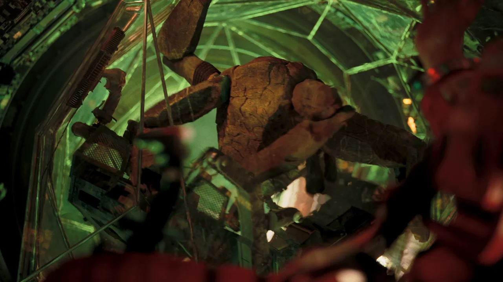
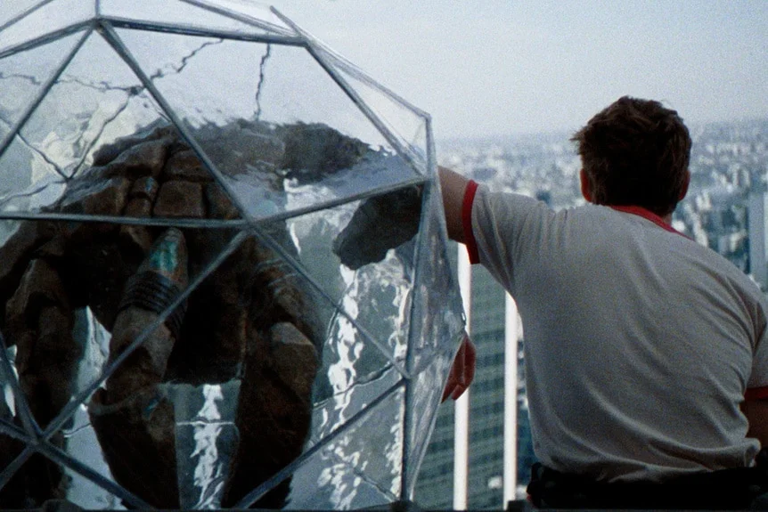
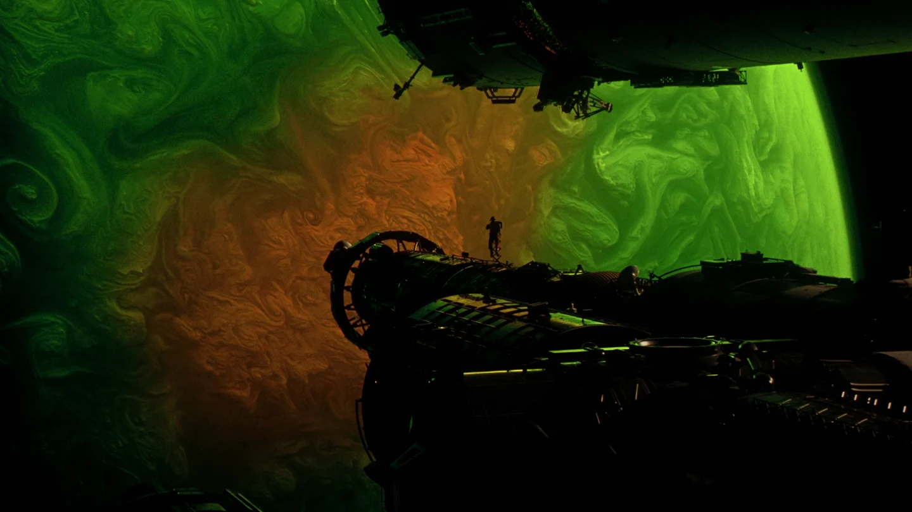

**有剧透。**

看之前总听人说，《挽救计划》是 2026 年最好看的电影。真轮到我看，前半段格雷斯还没遇到 Rocky，我倒先睡了五分钟。我平时看电影就这样：人一累，脑子里又在想别的事，情节稍微平缓一点就容易犯困。但我还是喜欢看电影。醒来以后，我慢慢被带进去了。等他们去那颗星球上采集噬星体的捕食者时，我已经替他俩捏了一把汗。

## Rocky 想有人陪它睡觉

散场后我最记得的，倒不是采集那场戏，而是 Rocky 想有人陪它睡觉。它也失去过同伴。我把它的请求理解成一种害怕：怕醒来以后，悲剧又重演，身边又只剩自己。两个一开始连对方的话都听不懂的陌生人，后来却能放心让对方守在身边。Rocky 的善意在这里很打动我，因为它不是天不怕地不怕，它也有需要朋友的时候。

## 被救下的不只是地球

我原来以为，片名里的「挽救」说的是格雷斯去救地球。后来才发现，Rocky 救过格雷斯，格雷斯也愿意回去救 Rocky。它给格雷斯的也不只是活下去的机会：在离家那么远的地方，还有一个朋友惦记着他。对我来说，让一个人没那么孤单，也是挽救。

我就是喜欢这种 Happy Ending。我会给它 **8.5 / 10**。

## 电影截图

*参考影评：[21 世纪经济报道](https://m.21jingji.com/article/20260418/29433428b5f7a04ee16875c605c8b054.html)、[美联社](https://apnews.com/article/project-hail-mary-movie-review-56616d8903dbd5c4339e1ca193e62013)。*
