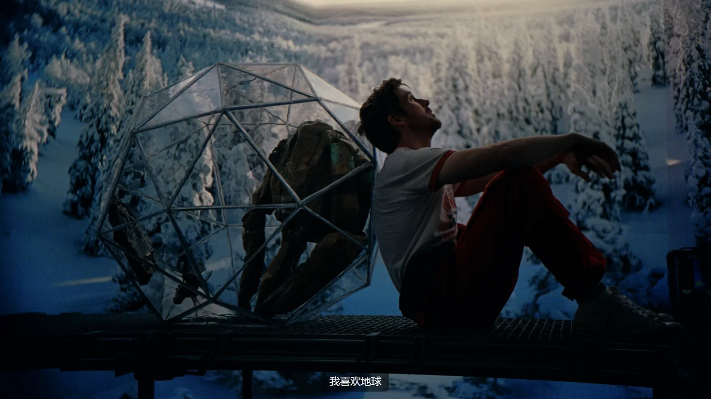
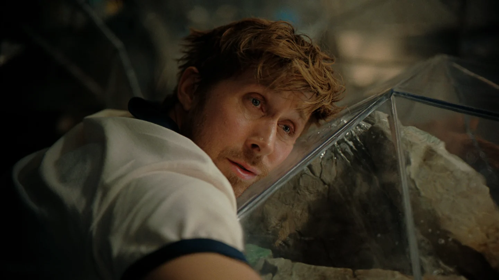
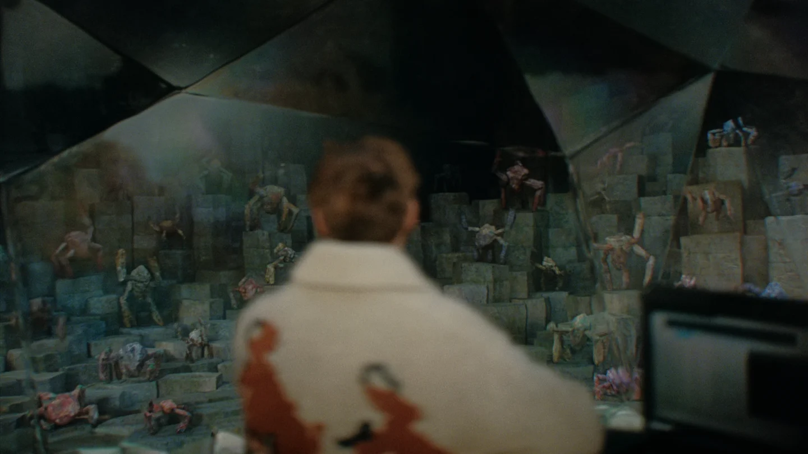

去之前总听人吹，《挽救计划》是 2026 年最好看的电影。结果真坐在家坐下，前半段格雷斯还没碰到 Rocky，我倒先迷糊了五分钟。我平时看电影就这样，人一累，脑子里还挂着别的事，前面节奏稍微平一点就容易犯困。好在后面慢慢看进去了，等他俩去那颗星球抓噬星体捕食者的时候，手心已经跟着捏了把汗。

## Rocky 想有人陪它睡觉

散场后脑子里留得最深的，反而不是采集那场戏，而是 Rocky 想让人陪它睡觉。它也失去过同伴，我总觉得它这个要求背后其实是害怕——怕一闭眼，醒过来悲剧又重演，身边又只剩自己一个。两个一开始连话都听不懂的陌生人，后来却能放心把后背交出去，让对方守在旁边睡觉。Rocky 最戳我的就在这，它不是什么天不怕地不怕的外星超人，它也会怕，也需要有个朋友在身边。

## 被救下的不只是地球

船舱里幽幽的绿光照在 Rocky 身上的那一幕，我到现在还记得。进场前我以为，片名里的「挽救」说的是格雷斯去救地球；看完才明白，其实是 Rocky 救了格雷斯，格雷斯也愿意掉头回去救它。Rocky 给他的不光是活下去的机会，而是在离家那么远的地方，还有个朋友惦记着你。对我来说，能让人没那么孤单，也算一种挽救。

我就是喜欢这种 Happy Ending。我会给它 **8.5 / 10**。

## 电影截图

*参考影评：[21 世纪经济报道](https://m.21jingji.com/article/20260418/29433428b5f7a04ee16875c605c8b054.html)、[美联社](https://apnews.com/article/project-hail-mary-movie-review-56616d8903dbd5c4339e1ca193e62013)。*
