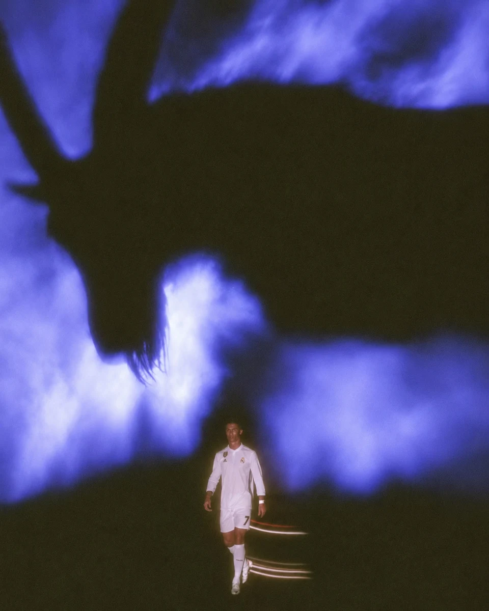
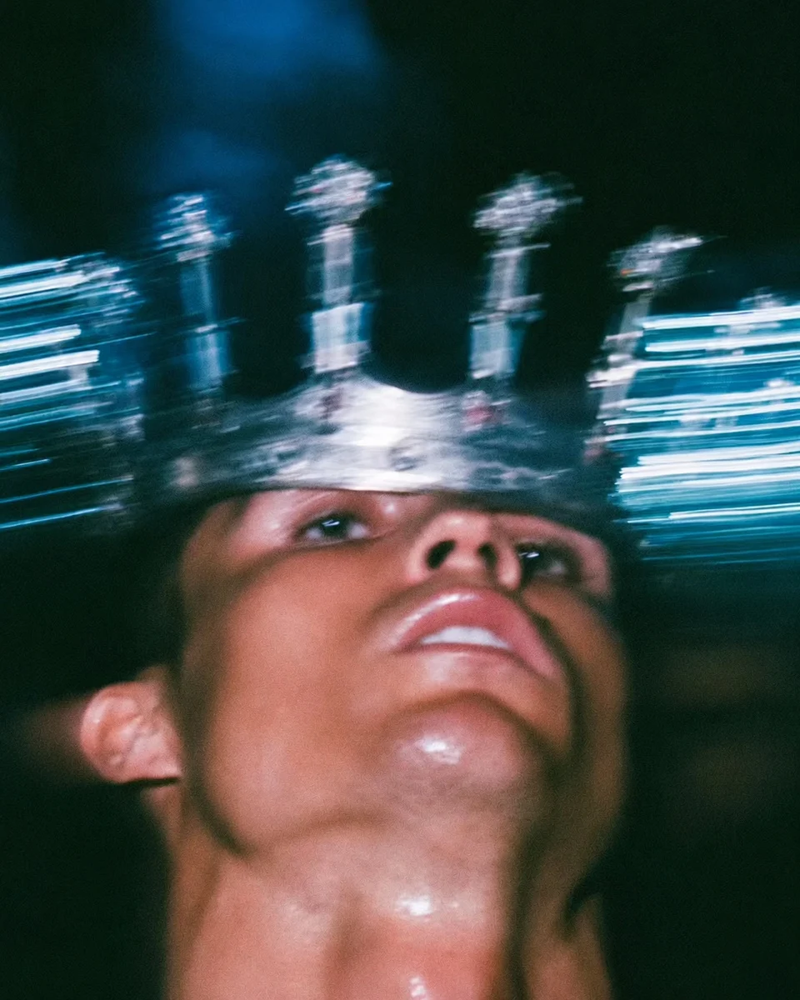
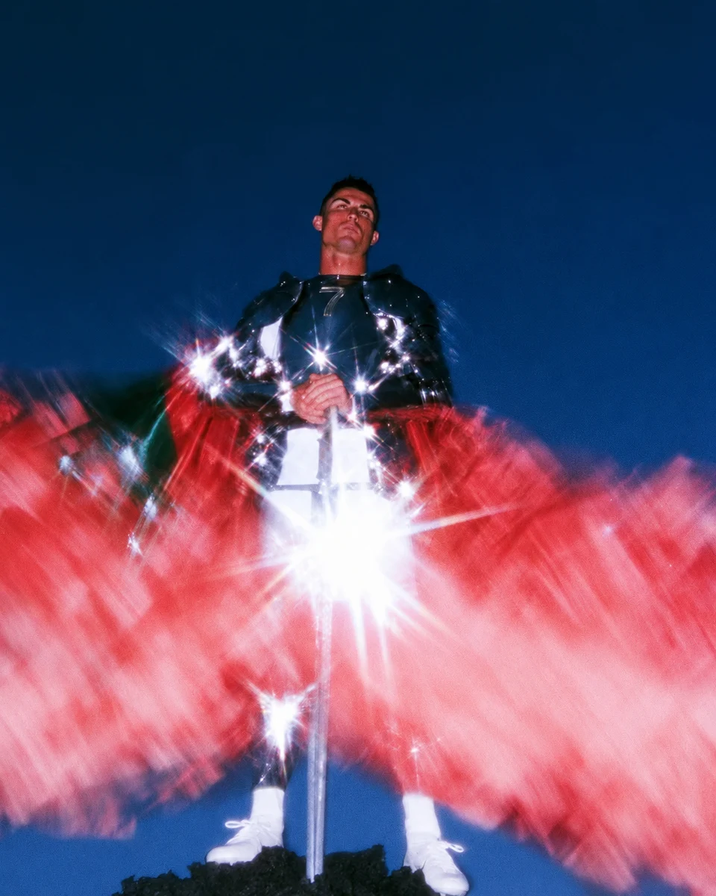
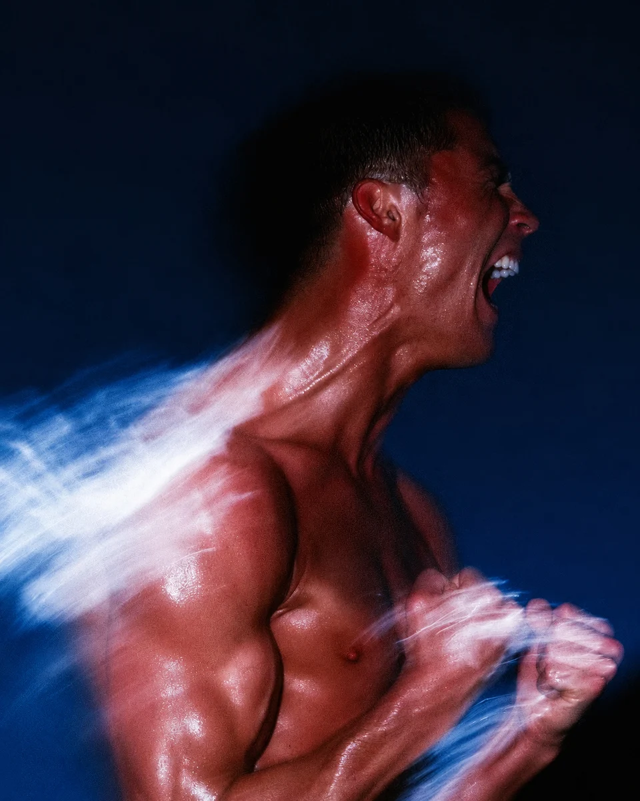
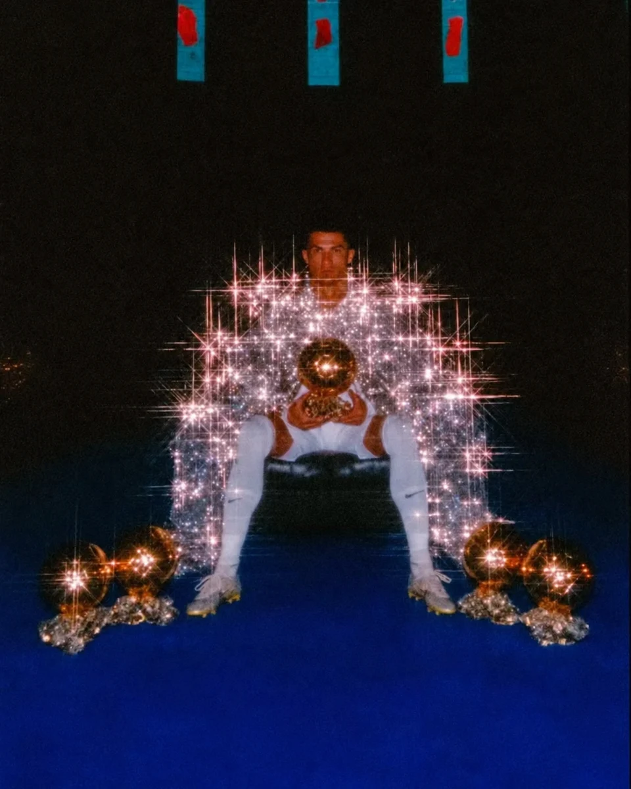
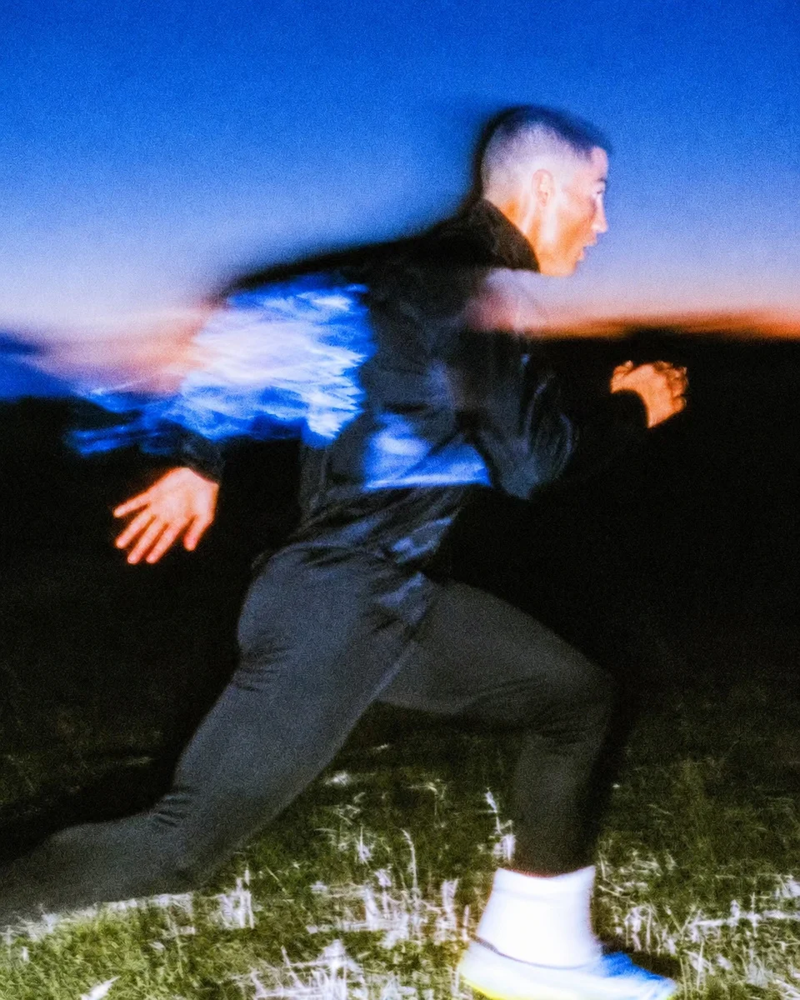
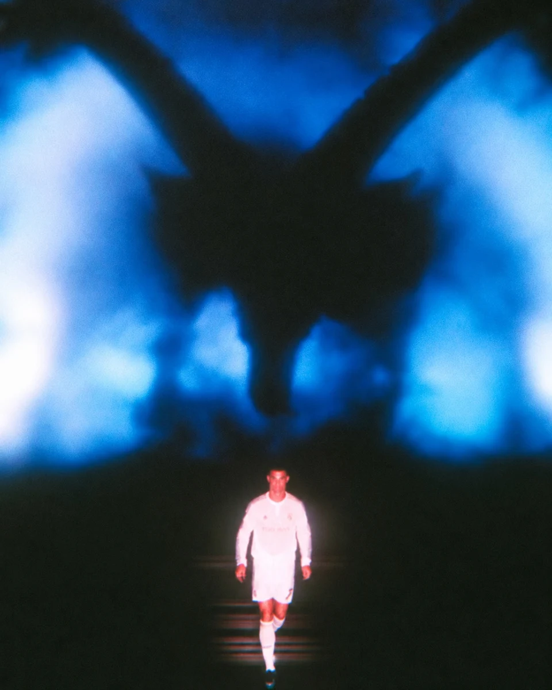
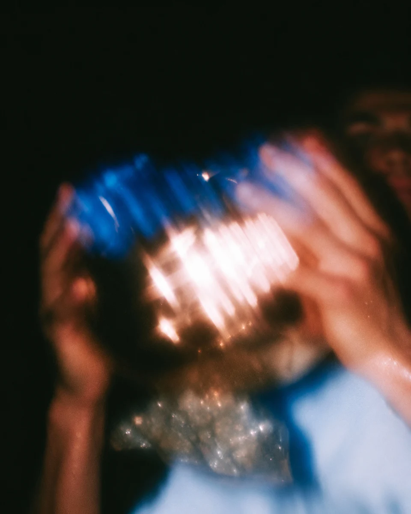

初中的时候，我更喜欢梅西。看他盘带，明明对手已经把路堵住了，他还是能从几个人中间把球带出来。场下的他又很谦逊，不怎么张扬。那时候我看球，光这两点就足够让我喜欢他了。

后来，我慢慢更喜欢 C 罗了。可能是生活里也有过一些不如意，我开始留意一个人得不到想要的结果时，会怎么做。回头看他和梅西较劲的那些年，我欣赏他那股不服输的劲儿。对手那么强，他还是愿意一次次去争。

2022 年梅西拿到世界杯，在我心里，他就是历史最佳。但在那之前，我一直觉得他和 C 罗是并驾齐驱的。单看国家队荣誉，C 罗确实没追上梅西，可足球毕竟是十一人的比赛，这个差距不能全算在他一个人身上。

在我看来，C 罗也是个了不起的领袖。他知道自己想要什么，事情不顺也没放弃自己的追求。当然，他有脾气，失望时也藏不住。我不觉得发脾气总是对的，但看到他也有不那么体面的时候，我反而觉得，他离我没那么远。

我现在还是很喜欢看梅西踢球。只是轮到自己遇上不顺时，我更常想起 C 罗。我也会着急，也会不甘心。我想学他的，是等那股情绪过去之后，还肯再试一次。

## C 罗照片

