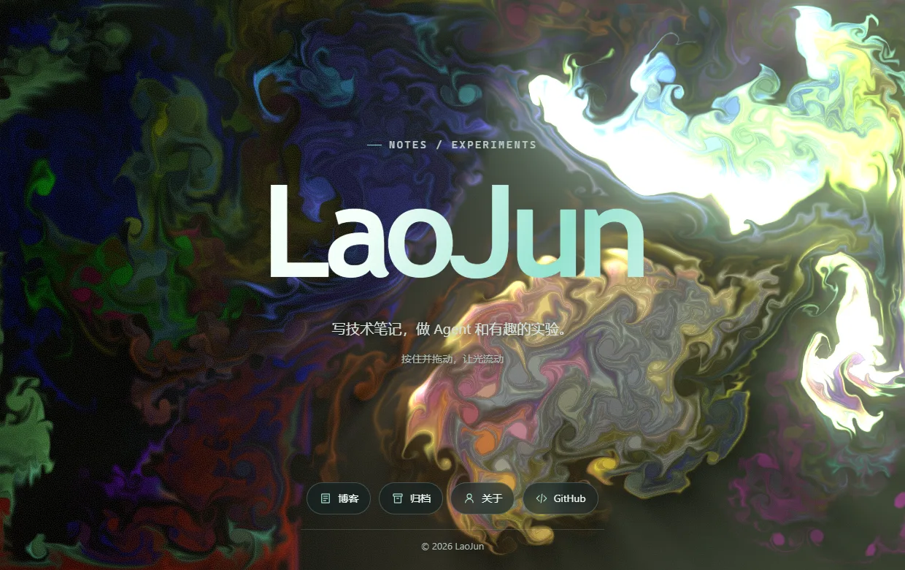
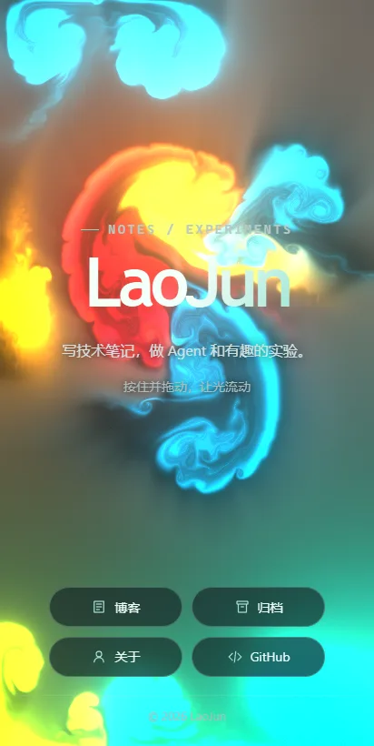

本站首页的光流不是视频，也不是一张会动的背景图。它用 [Pavel Dobryakov 的 WebGL Fluid Simulation](https://github.com/PavelDoGreat/WebGL-Fluid-Simulation) 在浏览器里实时计算：标题和导航是普通网页元素，颜色和流动由它们背后的 `<canvas>` 渲染。上方是打开本站首页后截到的开场画面。

## 先在首页试一下

1. [打开本站首页](../../)。刚打开时会随机生成几团颜色，所以每次看到的开场不一定相同。
2. 在电脑上把鼠标移到页面中央，**按住左键再拖动**。只悬停不会产生新颜色，按下后移动才会把颜色和推力加到画布里。拖过标题也可以，文字不会被选中。
3. 试试先走一条直线，再画一个小圈。快速划过时，流体受到的推动更明显；松开后不再注入新颜色，已经留下的颜色会继续流动并逐渐淡去。



手机上直接用一根手指在首页中央按住并移动。底部的博客、归档等入口仍然是普通链接，不是画布的一部分。



## 在本地运行

在本站项目的根目录执行：

```powershell
pnpm.cmd install --frozen-lockfile
pnpm.cmd dev
```

打开终端显示的本地地址，进入站点根路径，而不是 `/blog/`。依赖装过以后，日常只需要第二条命令。动画完全在浏览器中运行，不用启动后端，也不需要 API 密钥。

## 怎么接进 Astro 页面

本站把它拆成三层，改动时不用同时改三个文件：

| 文件 | 负责什么 |
| --- | --- |
| `src/pages/index.astro` | 放置画布、标题和导航，控制背景层级，并处理减少动态效果、标签页隐藏等状态 |
| `src/scripts/landing-fluid.ts` | 接收鼠标和触屏的 Pointer Events，把指针坐标转换成相对于画布的位置 |
| `src/scripts/vendor/webgl-fluid.js` | 封装原版流体引擎，负责颜色、速度、涡流和辉光，不包含演示页的调参面板 |

如果想在**本站的另一个 Astro 页面**试验，可以把下面的例子放到 `src/pages/fluid-demo.astro`。如果要移到别的项目，先把上表中的两个脚本文件连同它们的目录结构一起带过去，并保留上游 MIT 许可证声明。

```astro
<section id="fluid-demo">
  <canvas aria-hidden="true"></canvas>
  <h1>流体测试</h1>
</section>

<script>
  import { createLandingFluid } from "../scripts/landing-fluid";

  const surface = document.querySelector<HTMLElement>("#fluid-demo");
  const canvas = surface?.querySelector("canvas");
  if (surface && canvas && !matchMedia("(prefers-reduced-motion: reduce)").matches) {
    createLandingFluid(canvas, surface);
  }
</script>

<style>
  #fluid-demo {
    position: relative;
    isolation: isolate;
    min-height: 24rem;
    background: #061013;
    color: white;
    cursor: default;
    user-select: none;
    touch-action: pinch-zoom;
  }
  canvas {
    position: absolute;
    inset: 0;
    width: 100%;
    height: 100%;
    pointer-events: none;
  }
  h1 { position: relative; }
</style>
```

关键是 **画布在下，标题在上，指针事件交给外层容器**。这样拖过标题也能驱动画布，而 `user-select: none` 不会让拖动变成蓝色文字选区。只在需要效果的页面导入脚本，普通文章页就不会加载流体引擎。

## 想调效果，先改哪几个值？

本站保留了[原演示](https://paveldogreat.github.io/WebGL-Fluid-Simulation/)的默认设置。想做自己的版本，可以在 `src/scripts/vendor/webgl-fluid.js` 的 `config` 里每次只改一个值，然后刷新对比：

| 参数 | 默认值 | 调整后会怎样 |
| --- | --- | --- |
| `SPLAT_RADIUS` | `0.25` | 调大后，每次拖动注入颜色的范围更宽 |
| `SPLAT_FORCE` | `6000` | 调大后，相同的拖动会对流体施加更强的推力 |
| `DENSITY_DISSIPATION` | `1` | 调大后颜色消退更快；想让轨迹多留一会儿就调小 |
| `CURL` | `30` | 调大后更容易看到卷曲的漩涡 |
| `DYE_RESOLUTION` | 桌面默认 `1024`，移动端 `512` | 越高，颜色细节越多，GPU 开销也越大 |
| `BLOOM` 与 `SUNRAYS` | 默认开启 | 分别控制辉光和光束，可以单独开关对比 |

如果手机上感觉卡顿，先降低 `DYE_RESOLUTION`，再试着关闭光束或辉光。如果首页一直显示静态深色背景，先确认系统没有开启「减少动态效果」，再检查浏览器是否支持 WebGL。部分设备不支持所需的纹理过滤时，引擎会降低分辨率并关闭部分光效；如果无法初始化，标题和导航仍然可用。
